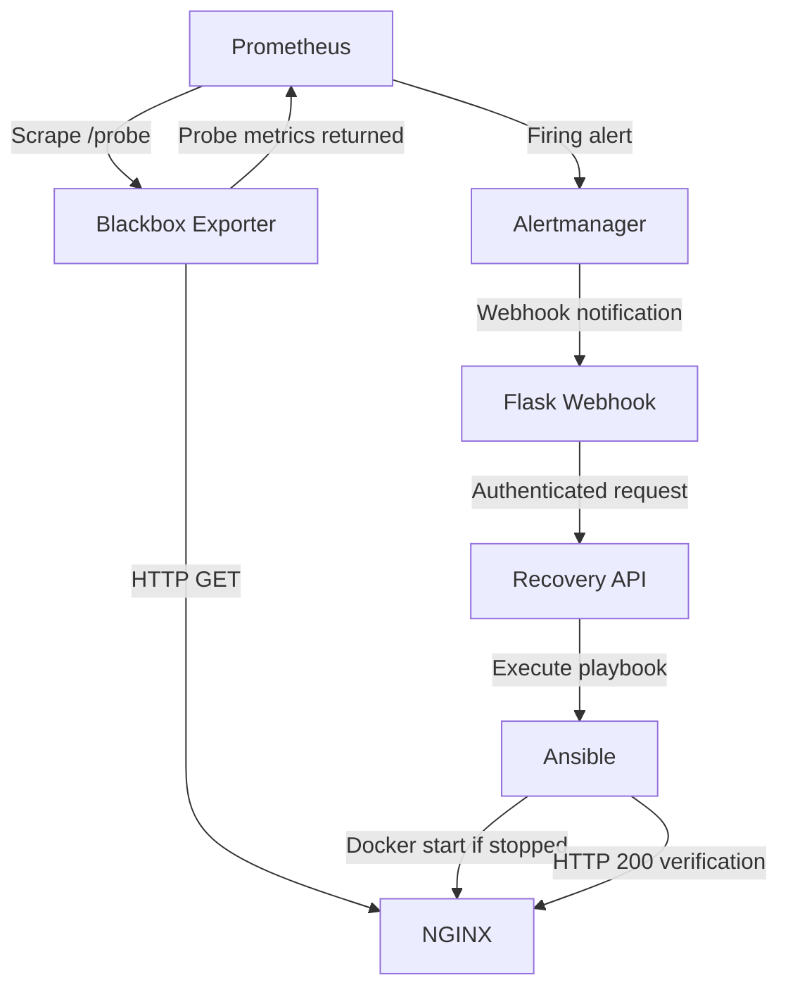
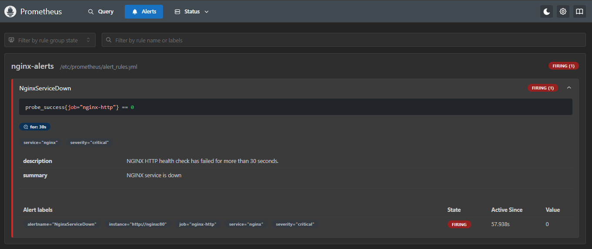
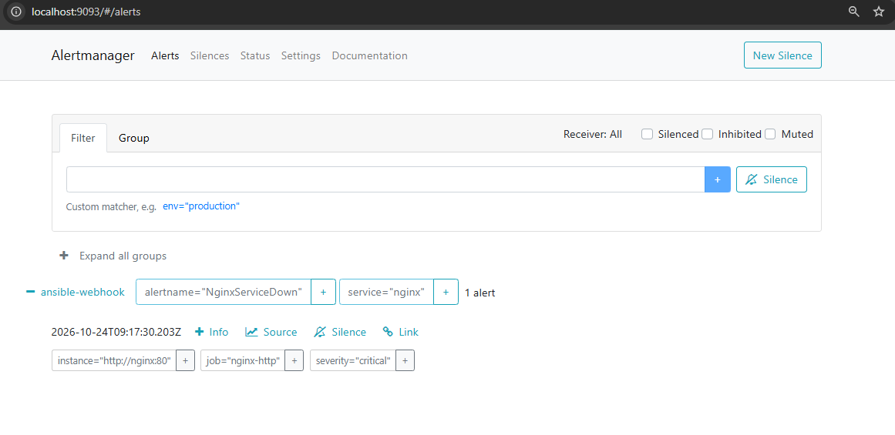

# Self-Healing Infrastructure with Prometheus, Alertmanager & Ansible

## Project Overview

This project demonstrates an automated self-healing infrastructure system that detects NGINX service failures and restores service availability using Prometheus, Alertmanager, Flask, and Ansible.

The infrastructure runs locally using Docker Compose, without requiring AWS or paid cloud services.

Prometheus monitors NGINX HTTP availability through Blackbox Exporter. When an HTTP availability failure persists beyond the configured alert threshold, Prometheus sends an alert to Alertmanager.

Alertmanager forwards the notification to a Flask webhook, which validates the alert and requests automated recovery through a separate recovery API. The recovery API authenticates the request and executes an Ansible playbook to restart NGINX when necessary.

After recovery, Ansible verifies that NGINX responds successfully with HTTP 200.

The project demonstrates monitoring, incident detection, alert routing, automated remediation, idempotency, and service health verification.

## Project Objectives

- Deploy NGINX as a monitored web service.
- Monitor HTTP availability using Prometheus and Blackbox Exporter.
- Detect service failures through Prometheus alert rules.
- Forward alerts using Alertmanager and a Flask webhook.
- Automatically recover a stopped NGINX container using Ansible.
- Prevent overlapping and excessive recovery attempts.
- Verify application availability after recovery.
- Demonstrate the complete self-healing workflow through controlled failure testing.
- Maintain logs and screenshots as evidence of successful recovery.

## Technologies Used

| Technology | Purpose |
|---|---|
| Docker & Docker Compose | Container deployment and networking |
| NGINX | Sample monitored web service |
| Prometheus | Metrics collection and alert evaluation |
| Blackbox Exporter | HTTP availability monitoring |
| Alertmanager | Alert notification routing |
| Python & Flask | Webhook receiver and recovery API |
| Ansible | Automated service recovery and health verification |
| Git & GitHub | Version control and project documentation |

## Architecture



The recovery automation uses the mounted Docker socket to inspect and start the NGINX container. Ansible then checks NGINX over HTTP. Docker socket access grants powerful host-level control and is intended here only for a controlled local development environment.


## Project Structure

```text
self-healing-infrastructure/
│
├── alertmanager/
│   └── alertmanager.yml          # Alert routing and webhook configuration
│
├── ansible/
│   ├── Dockerfile                # Custom Ansible image
│   ├── inventory.ini             # Local Ansible inventory
│   ├── recover_nginx.yml         # NGINX recovery and HTTP verification
│   └── test.yml                  # Ansible environment validation
│
├── blackbox/
│   └── blackbox.yml              # HTTP probing configuration
│
├── prometheus/
│   ├── prometheus.yml            # Scrape targets and Alertmanager integration
│   └── alert_rules.yml           # NGINX failure alert rule
│
├── recovery/
│   ├── Dockerfile                # Recovery API image
│   ├── app.py                    # Authenticated Ansible execution API
│   └── requirements.txt          # Python dependencies
│
├── webhook/
│   ├── Dockerfile                # Flask webhook image
│   ├── app.py                    # Alert validation and recovery forwarding
│   └── requirements.txt          # Python dependencies
│
├── screenshots/
│   ├── prometheus-alert-firing.png
│   ├── alertmanager-alert-firing.png
│   ├── webhook-recovery-log.txt
│   └── ansible-recovery-log.txt
│
├── .env.example                  # Example environment variable configuration
├── .gitignore                    # Git exclusions for secrets and temporary files
├── docker-compose.yml           # Multi-container infrastructure definition
└── README.md                    # Project documentation
```

### Important Files

- **`docker-compose.yml`** defines the six application, monitoring, and recovery services and their shared Docker network.
- **`prometheus/alert_rules.yml`** defines the `NginxServiceDown` alert.
- **`alertmanager/alertmanager.yml`** routes alert notifications to the Flask webhook.
- **`webhook/app.py`** validates incoming alerts and forwards approved recovery requests.
- **`recovery/app.py`** authenticates recovery requests and enforces execution safeguards.
- **`ansible/recover_nginx.yml`** conditionally starts NGINX and verifies HTTP availability.
- **`screenshots/`** contains evidence collected during controlled failure and recovery testing.

## Prerequisites

The project was developed and tested locally using:

- Windows with PowerShell
- Docker Desktop with Linux container support
- Docker Compose
- Visual Studio Code
- Git

An AWS account, cloud infrastructure, and a separate Ansible installation on the Windows host are not required.

Ensure Docker Desktop is running before starting the infrastructure.

## Installation and Setup

### 1. Clone the Repository

```powershell
git clone https://github.com/krutiknikhal/self-healing-infrastructure.git
cd self-healing-infrastructure
```

The clone command will work after this repository has been published to GitHub.

### 2. Configure the Recovery Token

Copy the example environment file:

```powershell
Copy-Item .env.example .env
```

Generate a cryptographically random recovery token using PowerShell:

```powershell
$bytes = [byte[]]::new(32)
[System.Security.Cryptography.RandomNumberGenerator]::Fill($bytes)
$token = [Convert]::ToHexString($bytes).ToLowerInvariant()
Set-Content -Path .env -Value "RECOVERY_TOKEN=$token"
Remove-Variable token, bytes
```

The token authenticates requests between the Flask webhook and recovery API.

**Security:** Never commit `.env` to GitHub. The `.gitignore` file excludes it.

### 3. Build the Ansible Image

```powershell
docker build -t self-healing-ansible:test ./ansible
```

This creates the custom image containing Ansible Core, the Docker CLI, and the recovery playbook.

The image must be built first because the recovery API Dockerfile uses `self-healing-ansible:test` as its base image.

### 4. Validate the Docker Compose Configuration

```powershell
docker compose config -q
```

This checks the Compose configuration without starting the services.

### 5. Build and Start the Infrastructure

```powershell
docker compose up -d --build
```

Docker Compose builds the Flask webhook and recovery API images, creates the shared network and named volumes, and starts all six services.

### 6. Verify Container Status

```powershell
docker compose ps
```

Confirm that the following services are running:

- `self-healing-nginx`
- `self-healing-prometheus`
- `self-healing-blackbox`
- `self-healing-alertmanager`
- `self-healing-webhook`
- `self-healing-recovery`

### 7. Access the Services

| Service | Local URL |
|---|---|
| NGINX | http://localhost:8081 |
| Prometheus | http://localhost:9090 |
| Alertmanager | http://localhost:9093 |
| Blackbox Exporter | http://localhost:9115 |
| Flask Webhook Health | http://localhost:5000/health |

The recovery API is accessible only through the internal Docker network and is not published to the Windows host.

### 8. Stop the Infrastructure

```powershell
docker compose stop
```

To start the existing containers again:

```powershell
docker compose start
```

To remove the containers and Compose network:

```powershell
docker compose down
```

Named volumes are retained by `docker compose down` unless the `-v` option is explicitly supplied.

## Monitoring and Alerting Workflow

### 1. HTTP Availability Monitoring

Prometheus monitors NGINX through Blackbox Exporter using the `nginx-http` scrape job.

Blackbox Exporter performs an HTTP GET request against:

`http://nginx:80`

The HTTP probe uses the `http_2xx` module, configured to accept HTTP status code `200`.

Prometheus collects the probe result every 15 seconds.

The primary availability metric is:

```promql
probe_success{job="nginx-http"}
```

- `1` indicates that the HTTP probe succeeded.
- `0` indicates that the HTTP probe failed.

A failed probe can result from a stopped service, connection failure, timeout, or unexpected HTTP response.

### 2. Prometheus Alert Rule

The `NginxServiceDown` alert is defined in `prometheus/alert_rules.yml`.

```yaml
- alert: NginxServiceDown
  expr: probe_success{job="nginx-http"} == 0
  for: 30s
  labels:
    severity: critical
    service: nginx
```

The alert enters the Pending state when the HTTP probe fails.

If the failure condition persists for 30 seconds, the alert becomes Firing during a subsequent rule evaluation.

Prometheus evaluates alert rules every 15 seconds, so the actual detection time depends on scrape and evaluation timing.

### 3. Alertmanager Notification Routing

Prometheus forwards firing alerts to Alertmanager at:

`alertmanager:9093`

Alertmanager groups notifications using the `alertname` and `service` labels.

The configured notification intervals are:

| Parameter | Value |
|---|---|
| Group wait | 10 seconds |
| Group interval | 1 minute |
| Repeat interval | 1 hour |

Alertmanager forwards notifications to the Flask webhook:

`http://webhook:5000/alert`

Resolved notifications are also forwarded, but the webhook ignores them for recovery purposes.

### 4. Flask Webhook Validation

The Flask webhook receives Alertmanager notifications through its `/alert` endpoint.

Before requesting recovery, it validates that:

- The notification status is `firing`.
- The individual alert status is `firing`.
- The alert name is `NginxServiceDown`.
- The service label is `nginx`.
- The severity label is `critical`.

Unrelated alerts and resolved notifications are ignored.

Approved notifications are forwarded to the recovery API through an authenticated HTTP POST request.

### 5. Automated Recovery

The recovery API receives requests at:

`http://recovery:5001/recover`

The API authenticates requests using the `X-Recovery-Token` header and accepts only NGINX recovery requests.

It implements an execution lock, a 60-second cooldown, and a 45-second Ansible execution timeout.

The recovery API invokes `ansible/recover_nginx.yml`, which:

1. Checks whether the NGINX container is running.
2. Starts the container only if it is stopped.
3. Verifies that NGINX responds with HTTP 200.

The HTTP verification task allows up to five attempts, with a two-second delay between retries.

If the playbook fails, the recovery API reports an error rather than returning a successful completion response.

### 6. Alert Resolution

After NGINX is restored, Blackbox Exporter can successfully probe the service again.

Prometheus subsequently observes:

```promql
probe_success{job="nginx-http"} == 1
```

The `NginxServiceDown` alert resolves once Prometheus evaluates the recovered condition.

Alertmanager can then forward a resolved notification to the webhook, which ignores it because no further recovery is required.

## Testing and Validation

The self-healing infrastructure was tested locally using controlled NGINX failures, Prometheus alerts, Alertmanager notifications, Flask webhook requests, and Ansible recovery execution.

### Test 1: Verify NGINX Availability

With the infrastructure running, NGINX was accessed through:

`http://localhost:8081`

The service returned HTTP `200`, confirming that the sample application was accessible.

### Test 2: Verify Monitoring and Alert Detection

NGINX was intentionally stopped using:

```powershell
docker compose stop nginx
```

Blackbox Exporter detected the HTTP availability failure, and Prometheus reported:

```promql
probe_success{job="nginx-http"} == 0
```

The `NginxServiceDown` alert transitioned to Firing after the configured threshold.

Alertmanager received the active alert and forwarded it to the configured Flask webhook.

**Prometheus firing alert:**



**Alertmanager active alert:**



### Test 3: Verify Automated NGINX Recovery

The webhook accepted the approved NGINX failure alert and forwarded an authenticated request to the recovery API.

The recovery API invoked the Ansible playbook, which restarted the stopped NGINX container and verified HTTP availability.

The final recovery test produced the following Ansible recap:

```text
localhost : ok=3 changed=1 unreachable=0 failed=0 skipped=0
```

This confirmed that the container-state check, conditional restart, and HTTP verification tasks completed successfully.

NGINX returned to the running state without a manual restart, and the recovery API returned HTTP `200`.

**Recovery evidence:** [Ansible recovery logs](screenshots/ansible-recovery-log.txt)

**Webhook evidence:** [Flask webhook logs](screenshots/webhook-recovery-log.txt)

### Test 4: Verify Ansible Idempotency

The recovery playbook was also executed while NGINX was already running.

The Ansible recap showed:

```text
localhost : ok=2 changed=0 unreachable=0 failed=0 skipped=1
```

This demonstrated that the playbook did not unnecessarily restart a running NGINX container.

The conditional restart task was skipped, while the HTTP availability verification succeeded.

### Test 5: Verify Recovery Request Safeguards

Additional API and webhook tests verified the following behaviors:

| Test | Observed result |
|---|---|
| Recovery request without a valid token | HTTP 401 Unauthorized |
| Recovery request for an unsupported service | HTTP 400 |
| Resolved alert notification | Ignored by webhook |
| Unrelated service alert | Ignored by webhook |
| Approved NGINX firing alert | Recovery request accepted |
| Recovery playbook execution | Completed successfully |

The recovery API also implements an execution lock and a 60-second cooldown to limit repeated recovery attempts.

### Test 6: Verify Alert Resolution

Following successful recovery, NGINX became accessible again.

Blackbox Exporter subsequently reported successful HTTP probes, and the Prometheus alert returned to its resolved state.

### Final Validation Summary

| Validation | Result |
|---|---|
| NGINX HTTP availability | Passed |
| Prometheus HTTP monitoring | Passed |
| NGINX failure alert | Passed |
| Alertmanager webhook forwarding | Passed |
| Flask alert filtering | Passed |
| Recovery API authentication | Passed |
| Ansible automated restart | Passed |
| Post-recovery HTTP verification | Passed |
| Ansible idempotency | Passed |
| Alert resolution | Passed |

The completed tests demonstrate automated detection and recovery of a stopped NGINX container in the local Docker environment. A fresh-clone installation has not yet been independently validated.

## Troubleshooting

The following issues were encountered and addressed during the local implementation.

### 1. Docker Compose YAML Formatting

**Issue:** YAML formatting and indentation errors occurred while preparing the Docker Compose configuration.

**Resolution:** Corrected the YAML structure and validated the configuration using:

```powershell
docker compose config -q
```

**Learning:** YAML indentation is significant. Configuration validation helps identify errors before deploying containers.

### 2. Port 8080 Already in Use

**Issue:** Port `8080` was already being used by a local Jenkins installation.

**Resolution:** Mapped NGINX to host port `8081` while retaining container port `80`:

```yaml
ports:
  - "127.0.0.1:8081:80"
```

**Learning:** Docker port publishing separates host ports from container ports, allowing services to coexist without port conflicts.

### 3. Outdated Ansible Playbook Inside the Recovery Image

**Issue:** The recovery container initially used an older version of the Ansible playbook, which executed `docker start` unconditionally.

This caused Ansible to report a change even when NGINX was already running.

**Cause:** The playbook had been updated locally, but the Docker image still contained the earlier version.

**Resolution:** Rebuilt the Ansible base image and recovery image, then recreated the recovery container:

```powershell
docker build -t self-healing-ansible:test ./ansible
docker compose build recovery
docker compose up -d --no-deps --force-recreate recovery
```

**Verification:** Repeated the idempotency test and confirmed that the restart task was skipped when NGINX was already running.

**Learning:** Files copied into Docker images during builds are not automatically updated when their local source files change.

### 4. Docker Log Output Formatting in PowerShell

**Issue:** Capturing container logs through PowerShell included development-server warnings and stderr formatting.

**Resolution:** Saved the actual Docker logs to text files for review and verified that the recovery results were present.

**Learning:** Container logs may contain both standard output and standard error. Evidence should be inspected before being included in documentation.

## Security Considerations and Limitations

This project was designed as a controlled local DevOps lab rather than a production-ready recovery platform.

### Implemented Safeguards

- **Token authentication:** The recovery API requires a valid `X-Recovery-Token` header.
- **Environment variable protection:** The recovery token is stored in `.env`, which is excluded from Git.
- **Service allowlist:** Automated recovery is restricted to the approved NGINX service.
- **Alert validation:** The webhook processes only approved firing alerts.
- **Execution lock:** A lock prevents overlapping recovery requests within the recovery API process.
- **Cooldown:** A 60-second cooldown limits repeated recovery attempts.
- **Execution timeout:** Ansible execution is limited to 45 seconds.
- **Conditional remediation:** Ansible starts NGINX only when the container is stopped.
- **Health verification:** Ansible checks for HTTP 200 after recovery.

### Known Limitations

1. **Docker socket access:** The recovery container mounts `/var/run/docker.sock`, granting powerful access to the Docker engine. This should not be exposed to untrusted workloads.

2. **Flask development server:** The webhook and recovery API use Flask's built-in development server, which is not intended for production deployment.

3. **In-memory safeguards:** The execution lock and cooldown are process-local and reset when the recovery API container restarts.

4. **Limited remediation scope:** The playbook restarts an existing stopped NGINX container. It does not recreate deleted containers or repair every possible application failure.

5. **Local deployment:** The implementation runs on Docker Desktop and has not been deployed to AWS or another cloud platform.

6. **HTTP monitoring only:** The implemented alert detects NGINX HTTP availability failures. CPU utilization alerts and broader infrastructure monitoring are outside the current tested scope.

For a production environment, further improvements would be required, including stronger isolation, restricted automation privileges, secure secret management, and more durable recovery coordination.

## Key Learnings

This project provided practical experience in:

- Deploying and managing multiple services using Docker Compose.
- Understanding container networking, host port mapping, bind mounts, and named volumes.
- Configuring Prometheus scrape targets and alert rules.
- Monitoring HTTP availability using Blackbox Exporter.
- Routing notifications through Alertmanager webhooks.
- Building Flask APIs to integrate monitoring with automation.
- Authenticating and validating automated recovery requests.
- Executing Ansible playbooks from a containerized environment.
- Implementing conditional remediation and idempotent automation.
- Verifying application health after service recovery.
- Troubleshooting outdated Docker images and configuration issues.
- Collecting operational logs and screenshots as implementation evidence.
- Applying security safeguards to reduce uncontrolled recovery attempts.

## Conclusion

The Self-Healing Infrastructure project successfully demonstrates an automated recovery workflow using Prometheus, Alertmanager, Flask, Docker, and Ansible.

The system detects NGINX HTTP availability failures, generates alerts, forwards approved notifications, and invokes an Ansible playbook to restore the stopped container.

The final implementation also verifies HTTP availability after recovery and avoids unnecessary restarts when NGINX is already running.

Controlled failure tests confirmed successful automated recovery, alert resolution, and Ansible idempotency.

The project demonstrates practical DevOps engineering concepts, including infrastructure monitoring, alert management, incident automation, troubleshooting, and service recovery.

It provides a foundation for further improvements toward production-grade self-healing infrastructure.